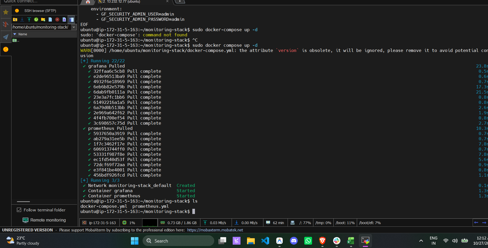
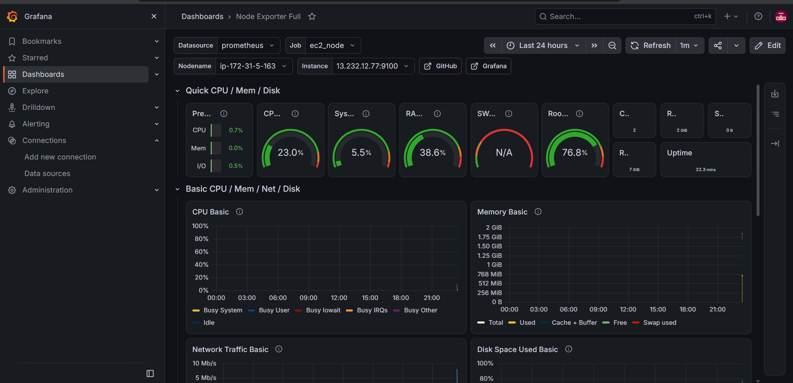
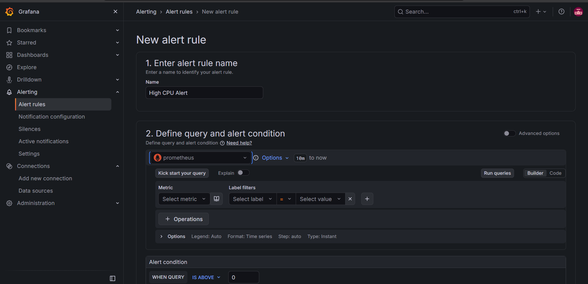
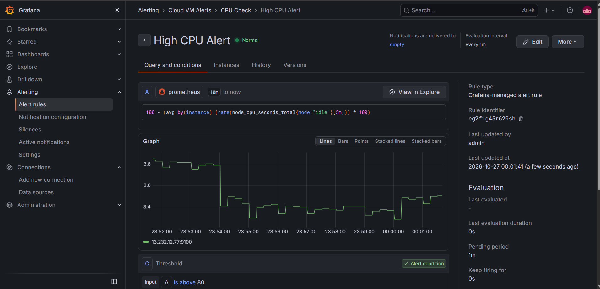
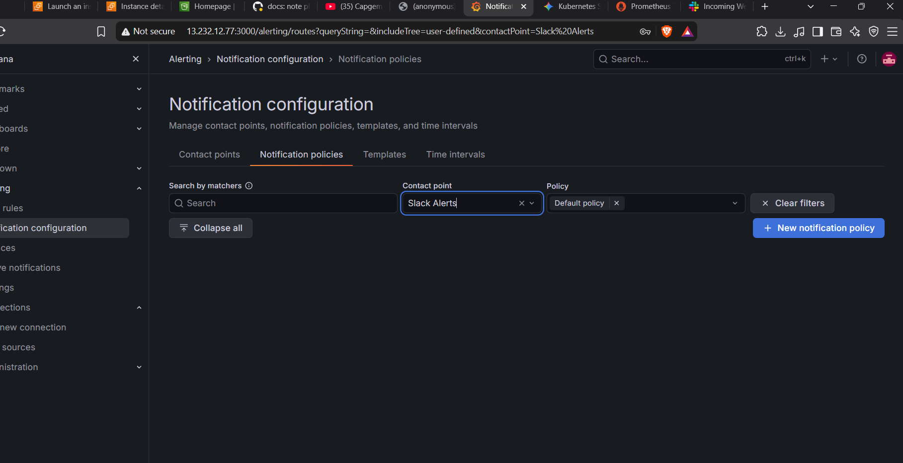

# Cloud-Based Virtual Machine Resource Monitoring System

An automated cloud infrastructure monitoring stack deployed on an AWS EC2 instance. This system utilizes Prometheus and Node Exporter for real-time metrics collection, Grafana for visual dashboards, custom PromQL rules for automated Slack alerting, and Python for generating scheduled CSV performance reports.

**Author:** Atharva Dilip Ramawat, Final Year B.Tech Data Science 

## 🏗️ Architecture & Tech Stack
* **Infrastructure:** AWS EC2 (Ubuntu Linux)
* **Containerization:** Docker & Docker Compose
* **Metrics Collection:** Prometheus & Node Exporter
* **Visualization & Alerting:** Grafana 
* **Notifications:** Slack Incoming Webhooks
* **Automation:** Python (Requests, CSV)

## ✨ Core Features
1. **Hardware Telemetry:** Node Exporter exposes kernel and machine-level metrics.
2. **Real-Time Dashboards:** Grafana visualizing CPU, Memory, Disk I/O, and Network traffic.
3. **Automated Alerting:** Custom PromQL queries trigger notifications to a dedicated Slack channel when CPU usage exceeds 80%.
4. **Performance Reporting:** Python script queries the Prometheus API to generate timestamped CSV resource reports.

## 📸 Project Gallery

### 1. Dockerized Infrastructure Deployment
The monitoring stack (Prometheus and Grafana) is containerized and deployed using Docker Compose on the AWS EC2 instance.
 

### 2. Live Grafana Telemetry Dashboard
Real-time hardware metrics tracking CPU, memory, and network traffic via the Prometheus data source.
 

### 3. PromQL Alert Rule Configuration
Defining a custom PromQL expression to evaluate idle CPU time and trigger an alert condition when usage exceeds the 80% threshold.
 

### 4. Active Alert Monitoring
The Grafana Alerting engine continuously evaluating the configured CPU rule against incoming time-series data.
 

### 5. Enterprise Notification Routing
Grafana Notification Policies configured with custom Contact Points to route triggered alerts directly to a dedicated Slack webhook.
 

## 🚀 Deployment & Execution Steps

Follow these steps to deploy the monitoring infrastructure on a fresh Ubuntu machine (like an AWS EC2 instance):

### 1. Clone the Repository
```bash
git clone [https://github.com/Atharva-Ramawat/Cloud_Based_Virtual_Machine_Resource_Monitoring_System_using_grafana_and_Prometheus.git](https://github.com/Atharva-Ramawat/Cloud_Based_Virtual_Machine_Resource_Monitoring_System_using_grafana_and_Prometheus.git)
cd Cloud_Based_Virtual_Machine_Resource_Monitoring_System_using_grafana_and_Prometheus
```

### 2. Launch the Monitoring Stack
Ensure Docker and Docker Compose are installed on your machine, then spin up the containers in detached mode:
```bash
sudo docker compose up -d
```
*(Verify the containers are running by executing `sudo docker ps`)*

### 3. Access the Grafana Dashboard
* Open your web browser and navigate to `http://<YOUR-EC2-PUBLIC-IP>:3000`.
* Log in using the default credentials configured in the environment variables (or `admin` / `admin`).
* Node Exporter and Prometheus will already be linked and actively scraping telemetry data.

### 4. Generate the Performance Report
To capture a point-in-time snapshot of the current CPU and RAM usage, execute the Python reporting script:
```bash
python3 generate_report.py
```
This will fetch the latest metrics via the Prometheus HTTP API and append them to `cloud_performance_report.csv`.
